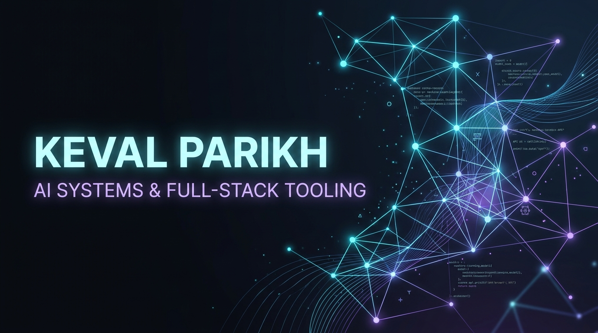

  

# 👋 Hi, I'm Keval Parikh
### AI Systems & Full-Stack Tooling Engineer

 

---

### ⚡ About Me

I design and engineer **autonomous AI agents, developer tooling, and high-performance web systems**. My work focuses on cutting token costs, optimizing multi-LLM orchestration, and building local-first software where user data never leaves their machine.

- 🛠️ **Creator of [conductor-ai](https://github.com/KevalParikh22/conductor-ai)**: Zero-dependency multi-agent orchestrator driving Claude Code, Codex, Antigravity, and Ollama with quota-aware fallback (reduces token burn by ~88%).
- 🧠 **Local AI & Privacy**: Architecting local-first audio transcription, semantic search, and RAG pipelines using Ollama & Whisper in **[YourTube](https://github.com/KevalParikh22/YourTube)**.
- 💼 **Available for**: AI Engineering consulting, custom agent workflows, developer productivity tooling, and full-stack web application development.

---

### 🚀 Featured Engineering Projects

<table>
  <tr>
    <td width="50%" valign="top">
      <h3 align="center">🎼 conductor-ai</h3>
      

        
        
        
      

      
Multi-LLM orchestrator where your lead agent plans and reviews while free/local models do the heavy typing. Features quota-aware fallbacks, git worktree isolation, and zero runtime dependencies.

      
<b>Tech Stack:</b> Node.js, CLI, MCP Server, Claude Code, Antigravity, Ollama, OpenRouter

    </td>
    <td width="50%" valign="top">
      <h3 align="center">📹 YourTube</h3>
      

        
        
        
      

      
Local-first assistant for processing YouTube backlogs. Transcribes videos locally, performs AI watch/skim ratings, and delivers cited semantic answers without leaking personal data.

      
<b>Tech Stack:</b> Python, Whisper, Ollama, yt-dlp, Vector Search, Knowledge Base

    </td>
  </tr>
  <tr>
    <td width="50%" valign="top">
      <h3 align="center">📊 AMS Platform</h3>
      

        
        
      

      
Full-stack modern management and tracking web platform deployed live with streamlined UI, real-time status management, and cloud architecture.

      
<b>Tech Stack:</b> JavaScript, React/Modern Web, Vercel, RESTful APIs

    </td>
    <td width="50%" valign="top">
      <h3 align="center">🖼️ Bulk Image Editor</h3>
      

        
        
      

      
Batch programmatic image editing and dynamic card generation utility designed for rapid mass personalization and asset production.

      
<b>Tech Stack:</b> Python, PIL/Pillow, Batch Automation, File Processing

    </td>
  </tr>
</table>

---

### 💻 Technologies & Tooling

| Area | Technologies |
| :--- | :--- |
| **AI & Agentic Systems** | `Claude Code` &bull; `Codex` &bull; `Antigravity` &bull; `Ollama` &bull; `Whisper` &bull; `MCP (Model Context Protocol)` &bull; `OpenRouter` &bull; `RAG` |
| **Languages** | `JavaScript (ESNext)` &bull; `TypeScript` &bull; `Python` &bull; `PHP` &bull; `Bash / Shell` &bull; `HTML5/CSS3` |
| **Backend & Tooling** | `Node.js` &bull; `Express` &bull; `REST APIs` &bull; `Git Worktrees & CI/CD` &bull; `Linux & Shell Automation` |
| **Frontend & Cloud** | `React` &bull; `Modern JavaScript` &bull; `Vercel` &bull; `GitHub Pages` &bull; `Vite` |

 

---

### 📈 Activity & GitHub Analytics

 

---

### 🤝 Let's Collaborate & Build

Whether you are looking to hire for an **AI/Full-Stack freelance contract**, need guidance on **multi-agent orchestration**, or have an open role:

- 📧 **Direct Email:** [kevalparikh22@gmail.com](mailto:kevalparikh22@gmail.com)
- 💼 **LinkedIn Profile:** [Connect on LinkedIn](https://www.linkedin.com/in/kevalparikh22/)
- 💬 **GitHub Discussions:** Feel free to open a topic on [conductor-ai discussions](https://github.com/KevalParikh22/conductor-ai/discussions)

  <i>Built with precision & passion for agentic systems.</i>

